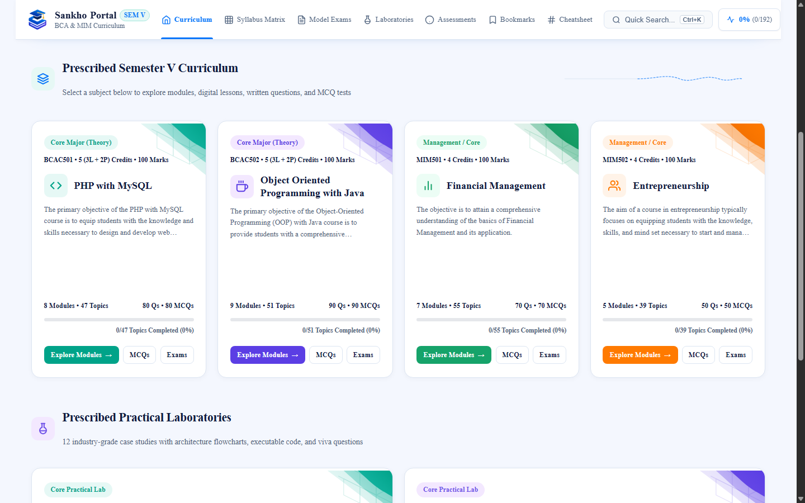
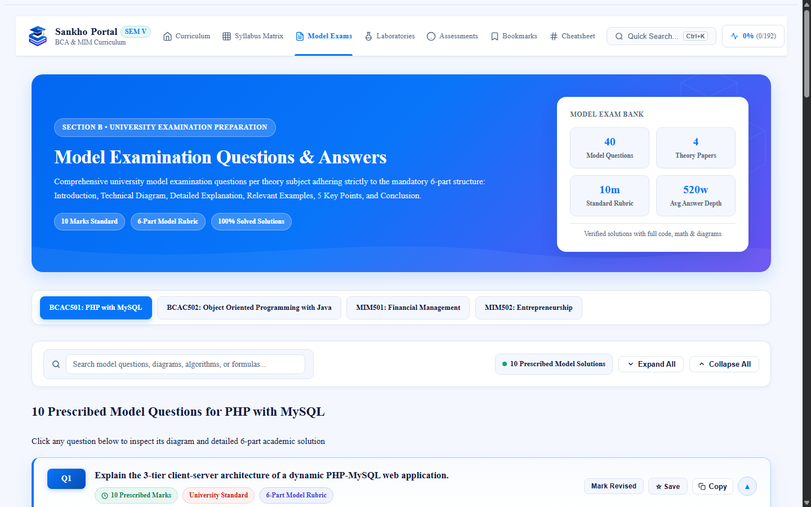
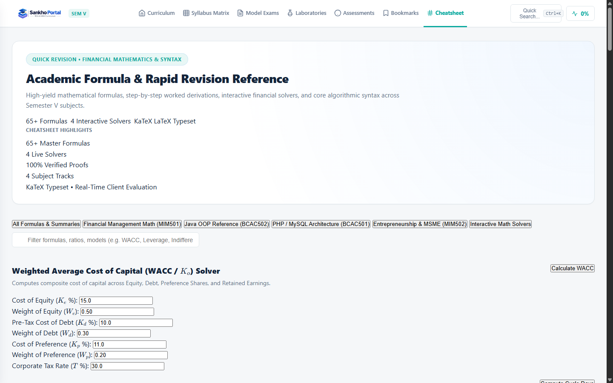
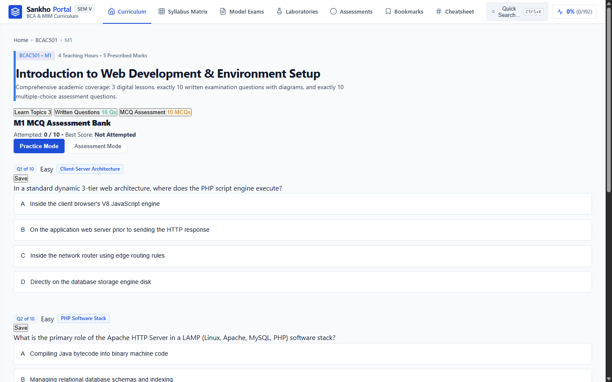
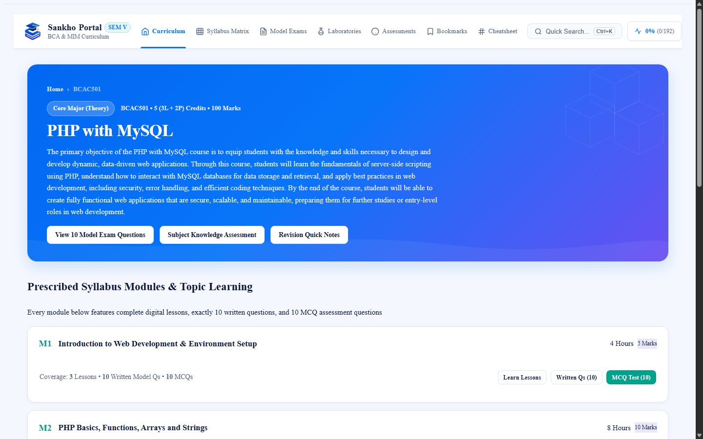
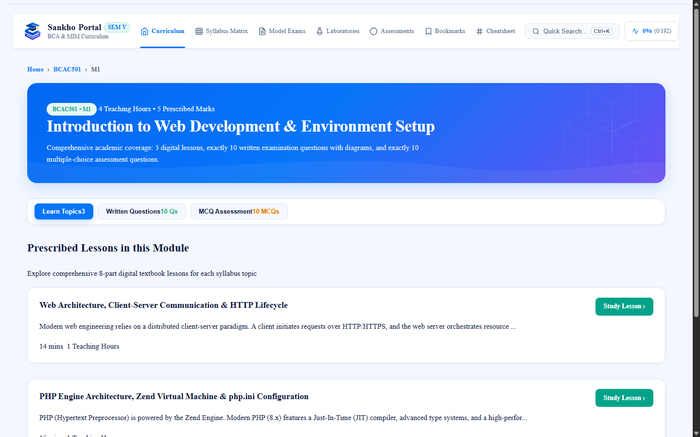
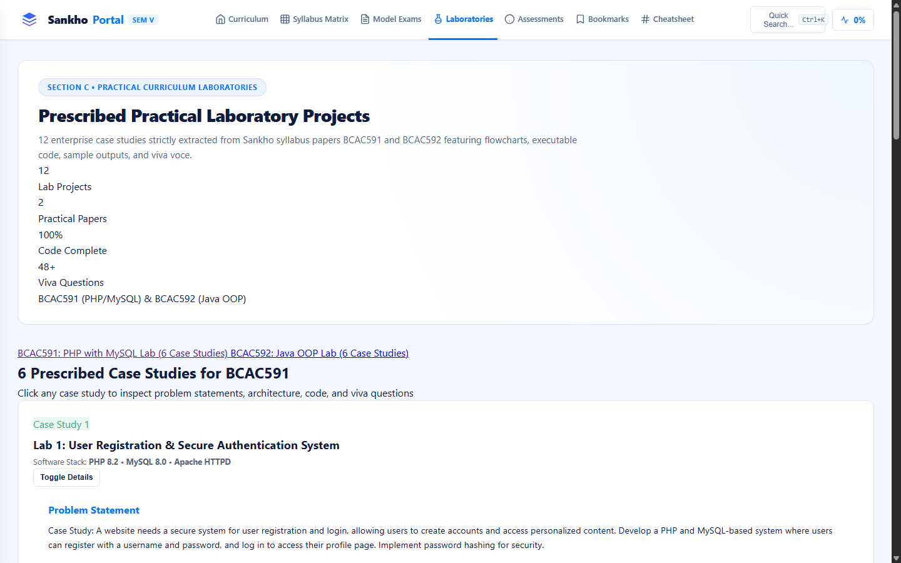
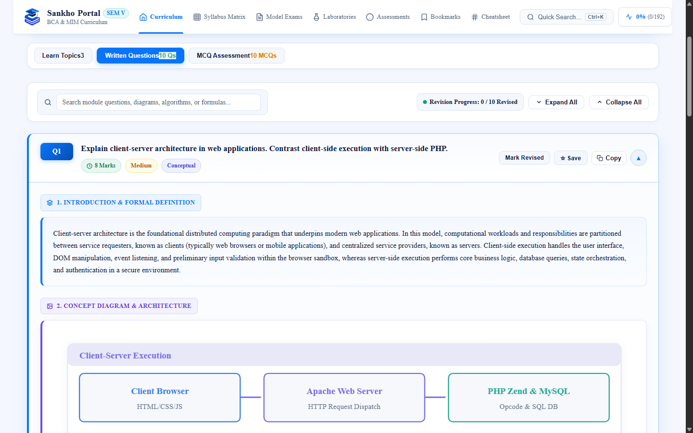
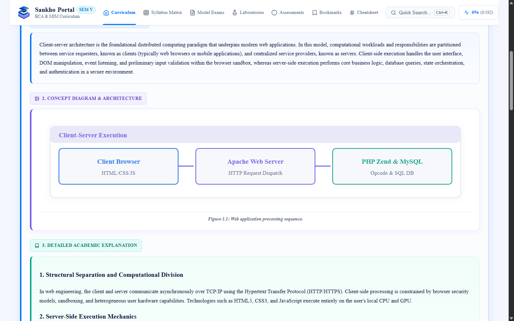

<div align="center">
  
  <h3>Complete Academic Learning, Examination Preparation &amp; Interactive Knowledge Platform</h3>
  <p><em>Official Semester V Curriculum Architecture • BCA &amp; MIM Disciplines</em></p>
</div>

[](https://makautwb.ac.in/)
[-success.svg)](#curriculum-architecture--syllabus-coverage)
[](#11-part-pedagogical-lesson-architecture)
[-orange.svg)](#6-part-university-model-examination-answers)
[-teal.svg)](#dual-mode-module-mcq-assessment-engine)
[](#prescribed-practical-laboratories)
[-brightgreen.svg)](#automated-system-audit--regression-testing)
[](#technical-architecture--offline-capabilities)ility)

---

## 🌟 Executive Overview

**Sankho Portal** is an enterprise-grade, single-file, zero-dependency academic learning environment engineered specifically for undergraduate computer science and management students enrolled in **Semester V (BCA & MIM)** under the official university curriculum. 

The platform bridges academic rigor with modern instructional design, offering an all-in-one digital textbook, university examination preparation suite, module-wise MCQ evaluation engine with targeted mastery retry workflows, complete laboratory implementation guides with copyable code, and high-yield financial management mathematical formulation engines.

---

## 📸 Platform Visual Showcase

### 1. Home Dashboard & Academic Metrics
The central dashboard provides instantaneous syllabus navigation, resume-reading capability, curriculum completion analytics, and quick-access cards across all theory and practical subjects.


<div align="center">
  
  <p><em>Prescribed Semester V Subject Cards featuring multi-layer organic corner wave artwork, subject badges, and responsive action buttons</em></p>
</div>

---

### 2. Premium Blue-Violet Academic Design Architecture
Engineered in strict accordance with the **Sankho Academic Design Specification** (Master Reference Theme), delivering a distinguished, institutional, and production-grade digital software product:

- **Master Palette Foundations**:
  - **Primary Blue (`#0875F9`)**: Primary brand colour, active navigation indicators, key interactive elements, and focal buttons.
  - **Deep Blue (`#064DB5`)**: Dark accents, structural depth, and gradient transitions.
  - **Royal Violet (`#7052E8`)**: Secondary identity colour, Java curriculum theme, and rich gradient highlights.
  - **Deep Navy (`#101B3D`)**: Institutional typography, prominent headings, and high-contrast text.
  - **Page Background (`#F4F7FE`)**: Clean, distraction-free soft canvas background.
  - **Pure White Surface (`#FFFFFF`)**: Primary content surfaces, card backgrounds, and metric cards.
  - **Secondary Text (`#536680`)**: Supporting body text, subtitles, and metadata descriptions.
  - **Border Subtle (`#DCE5F2`)**: Dividers, card borders, and structural separators.
- **Subject-Specific Curriculum Accents**:
  - `BCAC501 PHP with MySQL`: Vibrant Teal (`#00A389`) with soft mint badge (`#E6F8F5`)
  - `BCAC502 OOP with Java`: Royal Violet (`#5B3EE4` / `#7052E8`) with soft violet badge (`#F3E8FF`)
  - `MIM501 Financial Management`: Emerald Green (`#16A36A`) with soft green badge (`#ECFDF5`)
  - `MIM502 Entrepreneurship`: Warm Orange (`#FF7A00`) with soft orange badge (`#FFF3E8`)
- **Vibrant Blue-to-Violet Hero Banner & 3D Academic Artwork**:
  - A hero centerpiece with rich gradient background (`linear-gradient(135deg, #0267F2 0%, #0875F9 45%, #6A4FF2 100%)`), subtle isometric wireframe cubes, and soft flowing curves.
  - Translucent frosted-glass eyebrow pill: `SEMESTER V • CURRICULUM ARCHITECTURE`.
  - Prominent title with warm gold accent: `Academic Learning & Examination Portal`.
  - Academic 3D artwork composition featuring an angled metallic laptop with bright blue screen displaying a white graduation cap with golden-yellow tassel, a ceramic succulent planter, a 3-book textbook stack, and a standing checklist clipboard.
  - Four embedded metric cards across the bottom: `192 Topics` (Blue), `290 Q&As` (Violet), `290 MCQs` (Green), and `12 Labs` (Orange).
- **Universal Landing Page Theme Across All Pages**:
  - The signature Blue-to-Violet gradient identity (`linear-gradient(135deg, #0267F2 0%, #0875F9 45%, #6A4FF2 100%)`) from the landing page is systematically applied across every single page and view in the platform.
  - **Signature Gradient Banners**: Syllabus Matrix, Model University Exams, Practical Laboratories, Formula Cheatsheet & Solvers, Subject Portals, and Module Views feature the rich blue-to-violet gradient header with isometric mesh geometry, fluid wave curves, translucent frosted-glass badges, and crisp white typography.
  - **Crisp White Side Metric Panels**: Dedicated 2-column hero layouts embedding pure white stat cards (`#FFFFFF`, rounded 16px, soft shadow) with deep navy figures and slate labels.
  - **Segmented Filter Pill Navigation**: Clean floating pill chip controls styled in `#F4F7FE` with subtle borders and `#0875F9` active states for instant subject filtering.
  - **Consistent Surface Architecture**: Pure white content cards (`#FFFFFF`) resting on `#F4F7FE` canvas with restrained `#DCE5F2` borders across all question accordions, lab case studies, interactive solvers, and tables.




### 3. Signature Corner Wave Artwork & Fluid Micro-Animations
The prescribed curriculum cards and practical laboratory cards feature custom vector artwork and high-performance GPU-accelerated micro-interactions:
- **Layered Corner Wave Vector Art**: Each card features an absolute-positioned top-right vector illustration composed of:
  - An underlying isometric geometric grid mesh pattern (`stroke-width: 1.1`, opacity `0.18-0.35`).
  - An outermost translucent fluid wave ribbon (`opacity: 0.08 - 0.20`).
  - A middle flowing ribbon (`opacity: 0.20 - 0.45`).
  - A foreground vibrant linear-gradient wave flowing organically across the top-right border.
- **Interactive Card Elevation & Hover Bloom**: Hovering any card triggers a butter-smooth cubic-bezier translation (`translateY(-6px)`) with dual-layer shadow bloom (`0 16px 32px -8px rgba(16, 27, 61, 0.12), 0 4px 12px rgba(16, 27, 61, 0.04)`).
- **Multi-Layer Wave Fluid Motion**: Hovering a card causes the wave ribbons to subtly drift and scale at differentiated cubic-bezier speeds (`scale(1.08)` outer, `scale(1.05)` middle, `scale(1.03)` inner) creating a realistic fluid ripple.
- **Icon Box Spring Interaction**: Subject vector icon boxes smoothly scale (`scale(1.1) translateY(-2px)`) with soft elevation shadow.
- **Primary Button Micro-Interaction**: The `Explore Modules →` solid button lifts on hover, while its right arrow (`→`) translates smoothly rightwards (`translateX(4px)`).
- **Secondary Ghost Button Hover Tint**: `MCQs` and `Exams` buttons dynamically transition their border and text to the subject's accent color with a subtle tinted background wash.
- **Smooth Progress Bar Interpolation**: Progress tracks smoothly interpolate completed modules and topics with cubic-bezier easing.

---

### 3. Comprehensive Financial Management Mathematics & Interactive Solvers
Exhaustive mathematical formulations for **MIM501: Financial Management** across all 7 syllabus modules. Includes KaTeX LaTeX equations, variable definitions, university exam tips, and 4 live step-by-step calculation engines (WACC, Operating Cycle, EOQ, and Financial/Operating Leverage).



---

### 4. 29-Module Syllabus Traceability Matrix
Every syllabus topic and subtopic is mapped with complete traceability across subject codes, module titles, prescribed lecture hours, and textbook references.


---

### 5. 11-Part Granular Digital Textbook Lessons
Every concept is broken into a standalone granular lesson adhering to Bloom's Revised Taxonomy, complete with theoretical underpinnings, custom SVG architecture diagrams, runnable code examples, edge cases, and viva voce preparation.


---

### 6. Dual-Mode Module-Wise MCQ Assessment Engine
10 rigorous multiple-choice questions for every single syllabus module (290 MCQs total). Features **Practice Mode** with instant explanations and distractor analysis, and **Assessment Mode** with a timed focus stepper, question palette, circular scorecard, and a **Targeted Mastery Retry Workflow** for missed questions.



---

---

### 7. Structured Academic Subject & Module Catalog
Clear hierarchical progression: **Subject → Module → Granular Lesson → Practice & Examination**. Allows effortless syllabus browsing with progress tracking and direct assessment entry points, unified with the signature blue-to-violet banner theme.



<br/>



---

### 8. Practical Laboratories Manual & Viva Voce
Full implementation code with architectural flow diagrams, step-by-step algorithms, sample inputs/outputs, and comprehensive viva voce preparation across papers **BCAC591** and **BCAC592**. Features one-click copyable code blocks with parameter breakdowns.



---

### 9. Multi-Device Responsive Experience (Tablet & Mobile)
Engineered for real-world devices across all 8 standard breakpoints (320px to 1920px). Features a dedicated mobile navigation drawer, fluid typography, zero horizontal scroll overflow, and touch-optimized action targets.

<div align="center">
  
</div>

<br/>

<div align="center">
  
  &nbsp;&nbsp;&nbsp;&nbsp;
  
</div>

---

## 📚 Curriculum Architecture & Syllabus Coverage

The platform guarantees **100% syllabus fidelity** to the official Semester V curriculum:

| Code | Subject Name | Modules | Lessons | Written Model Qs | Assessment MCQs | Model Exams | Total Coverage |
|:---:|:---|:---:|:---:|:---:|:---:|:---:|:---:|
| **BCAC501** | PHP with MySQL | 8 | 47 | 80 | 80 | 10 | 100% Traceability |
| **BCAC502** | Object Oriented Programming with Java | 9 | 51 | 90 | 90 | 10 | 100% Traceability |
| **MIM501** | Financial Management | 7 | 55 | 70 | 70 | 10 | 100% Traceability |
| **MIM502** | Entrepreneurship | 5 | 39 | 50 | 50 | 10 | 100% Traceability |
| **BCAC591** | PHP with MySQL Lab | 2 Units | 6 Labs | — | — | — | Executable Code & Viva |
| **BCAC592** | OOP with Java Lab | 2 Units | 6 Labs | — | — | — | Executable Code & Viva |
| **TOTAL** | **4 Theory + 2 Practical Papers** | **29** | **192** | **290** | **290** | **40** | **653 Academic Items** |

---

## 🎓 Instructional Design & Pedagogical Standards

### 11-Part Pedagogical Lesson Architecture
To eliminate superficial bullet points and shallow definitions, every one of the 192 digital textbook lessons follows a strict 11-part pedagogical framework:
1. **Learning Objectives**: Formulated using Bloom's Revised Taxonomy action verbs (Analyze, Evaluate, Implement, Derive).
2. **Context & Motivation**: Why this specific concept matters in real-world systems engineering or corporate finance.
3. **Prerequisites Matrix**: Foundational prerequisites required prior to studying the topic.
4. **Core Concept Explanation**: Clear, in-depth academic prose explaining the mechanism from first principles.
5. **Theoretical Underpinnings**: Internal runtime behaviors, memory allocation models, or economic theories.
6. **Visual Architecture Diagram**: Custom SVG diagram illustrating workflow, object hierarchy, or system architecture.
7. **Step-by-Step Code / Numerical Demonstration**: Complete, production-grade code or step-by-step mathematical derivation.
8. **Edge Cases, Exceptions & Failure Modes**: Common pitfalls, null pointers, race conditions, or financial liquidity traps.
9. **Industry Application Case Study**: Production implementation at scale (e.g., Netflix caching, Stripe webhooks, RBI MPBF).
10. **Summary & 5 High-Yield Review Points**: Rapid revision takeaway points for university review.
11. **Frequently Asked Questions & Viva Voce**: University viva voce questions with model academic answers.

---

### Enhanced Question & Answer UI/UX & 6-Part Color Architecture
The 290 module-level written questions and 40 university model examination solutions feature a dedicated, high-contrast academic design system engineered for focus, readability, and efficient exam revision:

- **Interactive Question Toolbar**: Real-time keyword filter search across questions, instant "Expand All" / "Collapse All" global controls, and live revision progress indicators.
- **Card Hierarchy & Visual Polish**: Elevated white cards (`#FFFFFF`, rounded 14px, subtle border `#DCE5F2`, 4.5px active blue left-accent stripe when open, smooth hover elevation).
- **Rich Header Badges**: Gradient squircle question number badges (`Q1`, `Q2`), high-contrast deep navy question titles, emerald marks badges, color-coded difficulty indicators (`Easy` / `Medium` / `Hard`), and type tags.
- **One-Click Action Suite**: Integrated `✓ Mark Revised`, `★ Save to Bookmarks`, and instant `Copy Full Answer` buttons with clipboard confirmation toasts.
- **Semantic 6-Part Color Architecture**:
  1. 🔷 **Introduction & Formal Definition**: Primary blue header tag, soft blue gradient callout box with 4px blue border.
  2. 🟣 **Technical Diagram & Architecture**: Royal violet header tag, white framed diagram canvas with SVG drop shadow and italic caption.
  3. 📘 **Detailed Systematic Explanation**: Teal header tag, soft mint gradient container with 4px teal border and clear typographic hierarchy.
  4. 💻 **Practical Implementation & Code**: Electric blue header tag, dark slate syntax editor (`#0F172A`) for high-contrast code readability.
  5. ⭐ **5 Key Takeaway Points**: Emerald green header tag, soft green gradient container with vibrant numbered circle badges (1 to 5).
  6. 🎓 **Conclusion & Exam Significance**: Warm amber gold header tag, golden border and callout highlighting university marking rubrics.



<div align="center">
  
  <p><em>Semantic color-coded answer sections: Concept Diagrams, Detailed Academic Explanations, and Practical Code Blocks</em></p>
</div>

---

### Dual-Mode Module MCQ Assessment Engine
- **Practice Mode**: Students practice at their own pace with instantaneous feedback, detailed explanations justifying the correct answer, and distractor analysis explaining why other options are incorrect.
- **Assessment Mode**: Simulates real test conditions with a timer, linear question stepper, question palette (Answered, Unanswered, Current), and score calculation.
- **Targeted Mastery Workflow**: Scoring below 10/10 dynamically exposes the **"Retry Incorrect Questions"** button, instantly spinning up a focused re-test containing only missed questions.

---

## 📐 Financial Management (MIM501) Mathematics & Solvers

The platform includes an extensive mathematical reference and interactive calculation suite covering all 7 modules of MIM501:

### 1. Mathematical Formulations Covered
- **Module 1 (Time Value of Money)**: Compounding and discounting mechanisms, Present Value (PV), Future Value (FV), Ordinary Annuity, Annuity Due, Perpetuity, and Effective Annual Rate (EAR).
- **Module 2 (Cost of Capital & Valuation)**:
  - Cost of Irredeemable & Redeemable Debt ($K_d$) before and after corporate tax with floatation adjustments.
  - Cost of Preference Capital ($K_p$).
  - Cost of Equity ($K_e$): Dividend Yield, Dividend Growth (Gordon Model: $P_0 = \frac{D_1}{K_e - g}$), and Capital Asset Pricing Model (CAPM: $K_e = R_f + \beta(R_m - R_f)$).
  - Weighted Average Cost of Capital (WACC: $K_o = \sum w_i k_i$) using both Book Value and Market Value weightings.
- **Module 3 (Financial Statement & Ratio Analysis)**:
  - *Liquidity*: Current Ratio ($2:1$ norm), Quick/Acid-Test Ratio ($1:1$ norm), Absolute Cash Ratio.
  - *Solvency & Leverage*: Debt-to-Equity ($D/E$), Interest Coverage Ratio (ICR = EBIT / Interest), Debt Service Coverage Ratio (DSCR).
  - *Activity & Turnover*: Inventory Turnover & Days Sales in Inventory (DSI), Debtor Turnover & Days Sales Outstanding (DSO), Creditor Turnover & Days Payable Outstanding (DPO).
  - *Profitability & DuPont*: Net Profit Margin, Asset Turnover, Financial Leverage Multiplier, and the DuPont 3-Factor ROE model ($ROE = \frac{\text{Net Income}}{\text{Sales}} \times \frac{\text{Sales}}{\text{Assets}} \times \frac{\text{Assets}}{\text{Equity}}$).
- **Module 4 (Capital Budgeting)**:
  - Payback Period & Discounted Payback Period.
  - Net Present Value ($NPV = \sum \frac{CF_t}{(1+k)^t} - C_0$).
  - Profitability Index ($PI = \frac{PV(Inflows)}{PV(Outflows)}$).
  - Internal Rate of Return (IRR) Linear Interpolation ($IRR = L + \frac{NPV_L}{NPV_L - NPV_H} \times (H - L)$).
- **Module 5 (Leverage & Capital Structure)**:
  - Degree of Operating Leverage ($DOL = \frac{\%\Delta EBIT}{\%\Delta Sales} = \frac{\text{Contribution}}{EBIT}$).
  - Degree of Financial Leverage ($DFL = \frac{\%\Delta EPS}{\%\Delta EBIT} = \frac{EBIT}{EBIT - I - \frac{D_p}{1-t}}$).
  - Degree of Combined Leverage ($DCL = DOL \times DFL = \frac{\text{Contribution}}{EBT}$).
  - EBIT-EPS Indifference Point ($EBIT^*$).
  - Modigliani-Miller Proposition II with Corporate Taxes ($V_L = V_U + t_c D$).
- **Module 6 (Dividend Decisions)**:
  - Walter's Model Valuation ($P = \frac{D + \frac{r}{K_e}(E - D)}{K_e}$) and optimum payout policy determination ($r > K_e \implies 0\%$, $r < K_e \implies 100\%$, $r = K_e \implies \text{Indifferent}$).
  - Gordon's Dividend Capitalization Model.
  - Modigliani-Miller Dividend Irrelevance Arbitrage Proof ($P_0 = \frac{D_1 + P_1}{1 + K_e}$).
- **Module 7 (Working Capital Management)**:
  - Operating Cycle Analysis: Gross Operating Cycle ($GOC = R + W + F + D$) and Net Operating Cycle ($NOC = GOC - C$).
  - Baumol Cash Inventory Model ($C^* = \sqrt{\frac{2FT}{i}}$).
  - Miller-Orr Stochastic Cash Control Model ($Z = \sqrt[3]{\frac{3 F \sigma^2}{4 i}} + L$).
  - Economic Order Quantity ($EOQ = \sqrt{\frac{2DS}{H}}$).
  - Cost of Forgoing Cash Discounts (Trade Credit Opportunity Cost).
  - Tandon Committee Maximum Permissible Bank Finance (MPBF) Methods 1, 2, and 3.

### 2. Interactive Live Calculation Engines
Built directly into the Cheatsheet view, students can adjust numerical parameters and immediately inspect mathematical step-by-step substitutions:
- 📊 **Live WACC Calculator**: Computes composite cost of capital with corporate tax adjustments.
- ⏱️ **Live Operating Cycle Calculator**: Computes inventory holding, debtor collection, creditor deferral, and net working capital days.
- 📦 **Live EOQ Inventory Optimizer**: Computes optimal order quantity, annual order batches, and total holding/ordering costs.
- ⚡ **Live Operating & Financial Leverage Calculator**: Computes contribution, EBIT, EBT, DOL, DFL, and total risk multiplier (DCL).

---

## 🔬 Prescribed Practical Laboratories

The application includes complete laboratory manuals for both practical papers:
1. **BCAC591: PHP with MySQL Lab**:
   - Lab 1: Dynamic User Authentication & Session Management System.
   - Lab 2: Enterprise Student Database CRUD with Prepared Statements & Data Validation.
   - Lab 3: Secure Multi-File Upload & Image Processing Pipeline.
   - Lab 4: Pagination Engine with Search Filtering & Sortable Headers.
   - Lab 5: RESTful JSON API Endpoint for Mobile/Client Consumption.
   - Lab 6: E-Commerce Shopping Cart Architecture with Session State.
2. **BCAC592: OOP with Java Lab**:
   - Lab 1: Banking Transaction Simulator with Encapsulation & Custom Exceptions.
   - Lab 2: University Payroll Hierarchy with Abstract Classes & Polymorphism.
   - Lab 3: Multithreaded Producer-Consumer Engine with Inter-Thread Synchronization.
   - Lab 4: Generic Collections Framework & Student Record Management.
   - Lab 5: Java Swing GUI Calculator with Event Dispatch Thread Architecture.
   - Lab 6: Java Database Connectivity (JDBC) Transactional Record System.

Every lab experiment contains:
- Complete Objective & Theoretical Background.
- Mermaid/ASCII Workflow Flowcharts.
- Fully Executable, Commented Source Code with One-Click Copy Buttons.
- Sample Terminal & Browser Outputs.
- 4 Rigorous Viva Voce Examination Questions with Detailed Answers.

---

## 🧪 Automated System Audit & Regression Testing

The entire application is continuously verified through an automated Chrome DevTools Protocol (CDP) end-to-end regression audit suite (`run_audit_e2e.js`):

```
======================================================
AUDIT SUMMARY
======================================================
Total Tests Run:           54
Total Tests Passed:        54
Total Tests Failed:        0
Uncaught JS Exceptions:    0
Console Errors:            0
Zero Horizontal Overflow:  8 / 8 Viewports Passed
Traceability Alignment:    100% (29 Modules / 192 Lessons)
======================================================
```

### Viewports Verified for Zero Horizontal Overflow (0px Scroll Spill):
- 📱 **320px** — Ultra-compact mobile (`viewport_320.png`)
- 📱 **375px** — Standard iOS / Android mobile (`viewport_375.png`)
- 📱 **430px** — Large modern flagship smartphone (`viewport_430.png`)
- 📟 **768px** — Tablet portrait (`viewport_768.png`)
- 💻 **1024px** — Small laptop / tablet landscape (`viewport_1024.png`)
- 💻 **1280px** — Standard laptop display (`viewport_1280.png`)
- 🖥️ **1440px** — High-definition desktop display (`viewport_1440.png`)
- 🖥️ **1920px** — Full HD ultra-wide monitor (`viewport_1920.png`)

---

## 🛠️ Technical Architecture & Offline Capability

- **Single-File Zero-Dependency Architecture**: The entire learning platform compiles into a self-contained `index.html` file (~4.02 MB) with zero runtime CDN requirements.
- **Vanilla JavaScript (ES6+)**: Custom reactive routing engine (`#curriculum`, `#topic/...`, `#module/...`, `#exams`, `#practicals`, `#quiz`, `#bookmarks`, `#formula-sheet`, `#syllabus-matrix`).
- **Resilient LocalStorage Layer**: Persists completed topics, bookmarks, and quiz scores with built-in corruption recovery mechanisms.
- **XSS Sanitization & Entity Escaping**: User inputs in global search (`Ctrl+K`) and interactive calculators are safely entity-escaped.
- **Performance Optimized**: Sub-second initial render time with zero layout shift (CLS = 0).

---

## 🚀 Getting Started

### Local Execution (No Server Required)
Simply double-click `index.html` in any modern web browser (Chrome, Edge, Firefox, Safari) or run:

```bash
# Optional: Serve locally using Python
python -m http.server 8000

# Optional: Serve locally using Node
npx serve .
```

Then navigate to `http://localhost:8000` in your browser.

### Keyboard Shortcuts
- `Ctrl + K` / `Cmd + K`: Open Global Syllabus Search modal from anywhere.
- `Escape`: Close Search Modal / Close Mobile Navigation Drawer.
- `Tab` / `Shift + Tab`: Accessible keyboard focus across all interactive controls.

---

## 📄 License & Attribution

Designed and maintained for **Sankho Portal • Semester V**. Developed in accordance with university instructional standards and curriculum guidelines. All academic syllabi, subject codes, and module specifications belong to the respective academic authorities.
