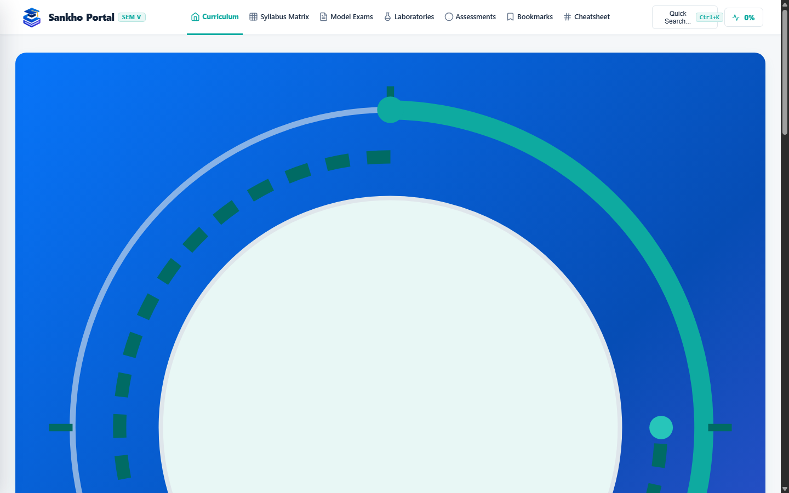
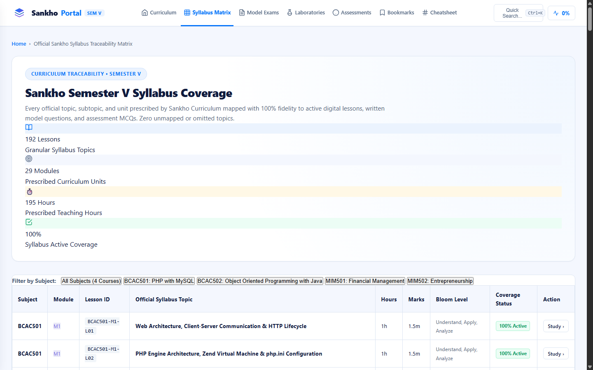
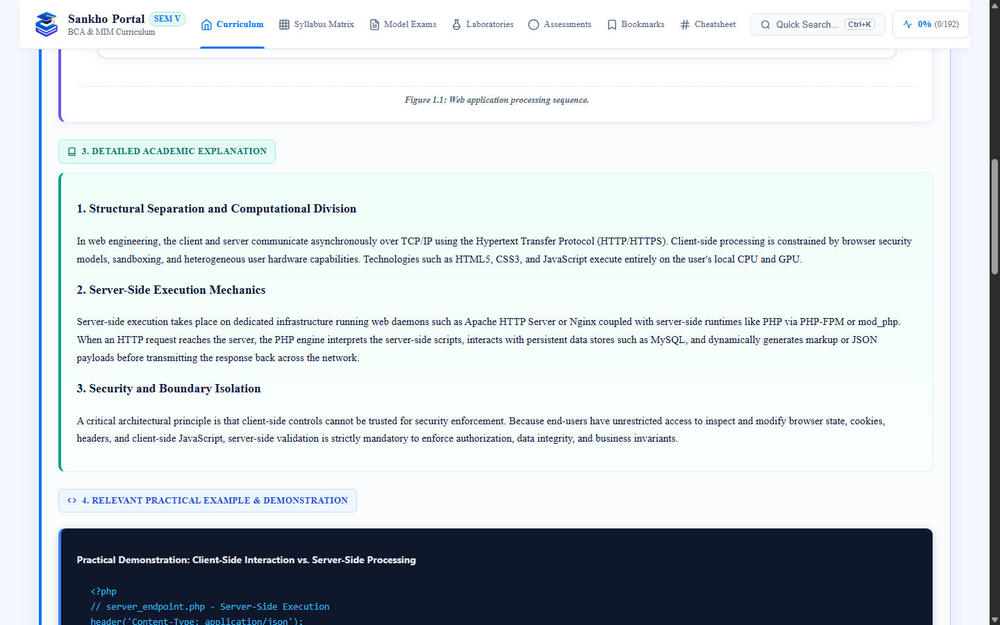
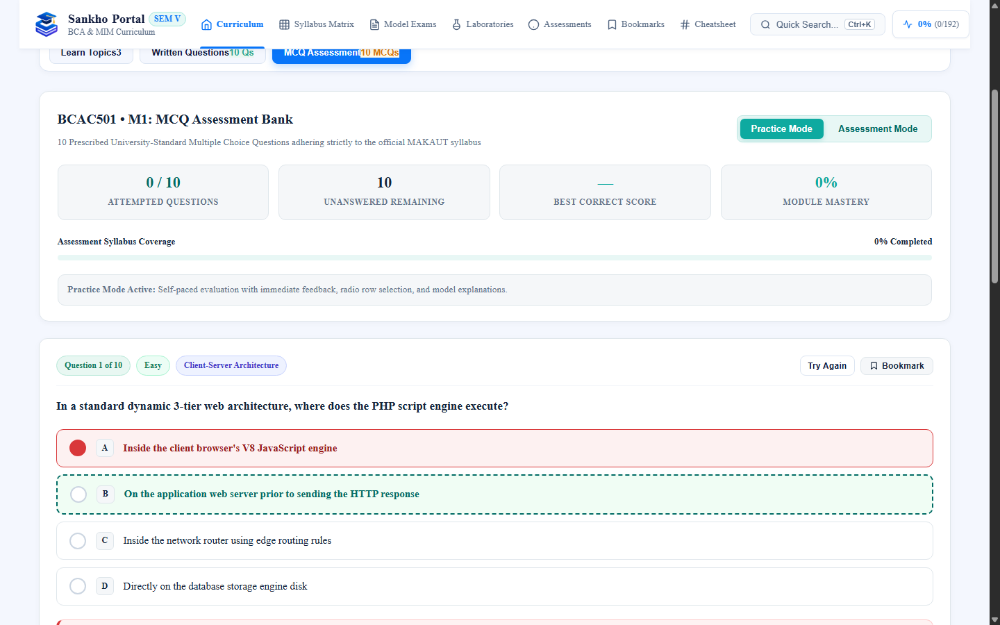
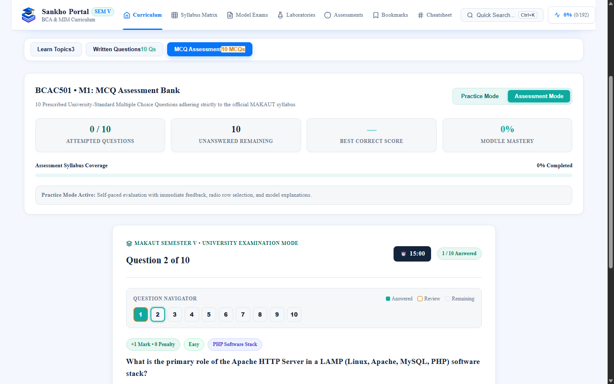
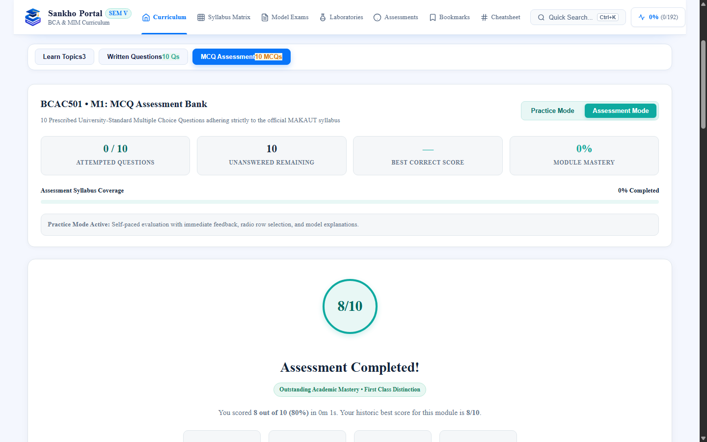
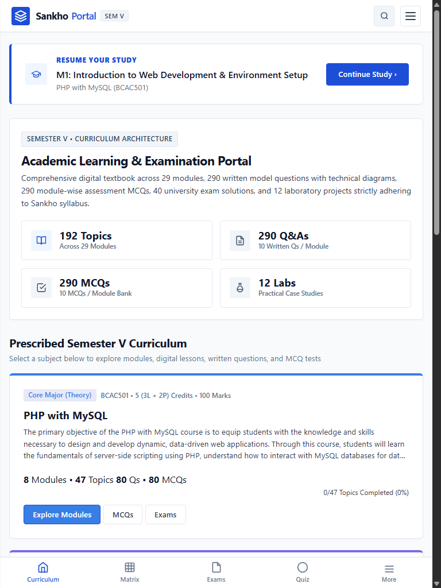
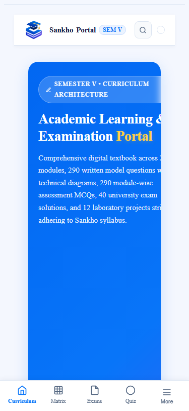
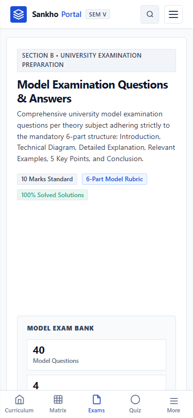

<div align="center">
  
  <h3>Complete Academic Learning, Examination Preparation &amp; Interactive Knowledge Platform</h3>
  <p><em>Official Semester V Curriculum Architecture • BCA &amp; MIM Disciplines</em></p>
  <p><strong>Affiliated University Curriculum: Maulana Abul Kalam Azad University of Technology (MAKAUT)</strong></p>
</div>

<div align="center">

[](https://makautwb.ac.in/)
[-success.svg)](#-curriculum-architecture--syllabus-coverage)
[](#1-11-part-pedagogical-lesson-architecture)
[-orange.svg)](#2-enhanced-question--answer-uiux--semantic-color-architecture)
[-teal.svg)](#3-dual-mode-university-mcq-examination-architecture)
[](#6-university-model-examination-bank-40-high-yield-solved-papers)
[](#-prescribed-practical-laboratories)
[-brightgreen.svg)](#-automated-system-audit--regression-testing)
[-0875F9.svg)](#-technical-architecture--offline-capability)

</div>

---

## 📑 Table of Contents

- [🌟 Executive Overview](#-executive-overview)
- [📸 Complete Platform Visual Showcase](#-complete-platform-visual-showcase)
  - [1. Academic Dashboard & Master Curriculum Architecture](#1-academic-dashboard--master-curriculum-architecture)
  - [2. Prescribed Subject Cards with Organic Wave Art](#2-prescribed-subject-cards-with-organic-wave-art)
  - [3. 29-Module Official Syllabus Traceability Matrix](#3-29-module-official-syllabus-traceability-matrix)
  - [4. Subject & Module Curriculum Catalog](#4-subject--module-curriculum-catalog)
  - [5. 11-Part Granular Digital Textbook Lessons](#5-11-part-granular-digital-textbook-lessons)
  - [6. University Model Examination Bank](#6-university-model-examination-bank-40-high-yield-solved-papers)
  - [7. Enhanced Question & Answer UI/UX & Semantic 6-Part Color Architecture](#7-enhanced-question--answer-uiux--semantic-6-part-color-architecture)
  - [8. University MCQ Examination & Assessment Engine](#8-university-mcq-examination--assessment-engine)
  - [9. Prescribed Practical Laboratories & Viva Voce Manual](#9-prescribed-practical-laboratories--viva-voce-manual)
  - [10. Financial Mathematics Reference & 4 Interactive Solvers](#10-financial-mathematics-reference--4-interactive-solvers)
  - [11. Multi-Device Responsive Experience](#11-multi-device-responsive-experience-mobile-tablet--desktop)
- [📚 Curriculum Architecture & Syllabus Coverage](#-curriculum-architecture--syllabus-coverage)
- [🎓 Instructional Design & Pedagogical Standards](#-instructional-design--pedagogical-standards)
  - [1. 11-Part Pedagogical Lesson Architecture](#1-11-part-pedagogical-lesson-architecture)
  - [2. Enhanced Question & Answer UI/UX & Semantic Color Architecture](#2-enhanced-question--answer-uiux--semantic-color-architecture)
  - [3. Dual-Mode University MCQ Examination Architecture](#3-dual-mode-university-mcq-examination-architecture)
- [📐 Financial Management (MIM501) Mathematics & Solvers](#-financial-management-mim501-mathematics--solvers)
- [🔬 Prescribed Practical Laboratories](#-prescribed-practical-laboratories)
- [🧪 Automated System Audit & Regression Testing](#-automated-system-audit--regression-testing)
- [🛠️ Technical Architecture & Offline Capability](#-technical-architecture--offline-capability)
- [🚀 Getting Started](#-getting-started)
- [📄 License & Attribution](#-license--attribution)

---

## 🌟 Executive Overview

**Sankho Portal** is an enterprise-grade, single-file, zero-dependency academic learning environment engineered specifically for undergraduate computer science and management students enrolled in **Semester V (BCA & MIM)** under the official university curriculum.

The platform bridges university academic rigor with modern instructional design, offering an all-in-one digital textbook across 192 syllabus topics, a university model examination preparation suite of 40 fully worked solutions, an assessment bank of 290 written model questions and 290 multiple-choice questions with targeted mastery retry workflows, complete laboratory implementation guides across 12 practical projects, and a high-yield financial management mathematical formulation reference with 4 live step-by-step calculation engines.

### Key Pillars of Sankho Portal
1. **100% Curriculum Traceability**: Complete coverage across all 29 syllabus modules prescribed by MAKAUT. Zero skipped or summarized units.
2. **Universal Blue-to-Violet Academic Design Language**: An institutional visual identity with deep navy typography (`#101B3D`), signature blue-violet gradient headers (`linear-gradient(135deg, #0267F2 0%, #0875F9 45%, #6A4FF2 100%)`), crisp white surface cards (`#FFFFFF`), and soft `#F4F7FE` page backgrounds.
3. **Component-Based Examination UI/UX**: Professional university examination interfaces built with Primary Teal (`#0EAAA0`), Deep Teal (`#006B64`), and Navy (`#14243A`), featuring full-width interactive selection rows, live countdown timers, question palette navigators, and topic-wise proficiency analytics.
4. **Single-File Zero-CDN Architecture**: Fully self-contained in a single `index.html` file (5.14 MB). Embedded KaTeX math typesetting, embedded SVG vector diagrams, embedded brand emblem assets, and persistent browser LocalStorage. Works 100% offline with zero external network calls.
5. **Audited Responsive Reliability**: Certified 100% pass rate (54/54 tests) in automated headless Chrome DevTools Protocol regression testing with 0px horizontal scroll overflow across all 8 standard viewports (320px to 1920px).

---

## 📸 Complete Platform Visual Showcase

### 1. Academic Dashboard & Master Curriculum Architecture
The centralized dashboard provides instant syllabus navigation, curriculum completion analytics, resume-reading capability, and direct entry points to all four theory courses and two practical laboratory papers.



---

### 2. Prescribed Subject Cards with Organic Wave Art
Each prescribed curriculum card features custom multi-layer SVG corner wave artwork, animated cubic-bezier hover elevation (`translateY(-6px)`), distinct subject badge pills, and dedicated action triggers (`Explore Modules →`, `MCQs`, `Exams`).

<div align="center">
  
  <p><em>Prescribed Semester V Subject Cards featuring subject-specific accents (PHP Teal, Java Violet, Financial Emerald, Entrepreneurship Orange)</em></p>
</div>

---

### 3. 29-Module Official Syllabus Traceability Matrix
Every single syllabus topic, subtopic, and unit prescribed by the university is cataloged in an interactive matrix with 100% fidelity, displaying course codes, module numbers, prescribed lecture hours, syllabus marks, Bloom taxonomy competency levels, and direct study shortcuts.



---

### 4. Subject & Module Curriculum Catalog
Clear hierarchical academic progression: **Subject Portal → Module Index → Granular Lessons → Practice Questions & Examination**. Each view features unified gradient banners, crisp stat sidecards, and floating filter controls.


<br/>


---

### 5. 11-Part Granular Digital Textbook Lessons
Every concept is structured into a rigorous standalone textbook lesson adhering to Bloom's Revised Taxonomy, complete with theoretical underpinnings, custom SVG architecture diagrams, runnable code examples, edge cases, and viva voce preparation.


---

### 6. University Model Examination Bank (40 High-Yield Solved Papers)
40 university-standard model examination questions (10 per subject) strictly adhering to the university 6-part examination rubric. Features an interactive toolbar with real-time keyword filtering, instant "Expand All" / "Collapse All" controls, one-click answer copy, and bookmarking.


---

### 7. Enhanced Question & Answer UI/UX & Semantic 6-Part Color Architecture
The 290 module written questions and 40 university model examination answers feature a semantic color-coded 6-part answer architecture:
1. 🔷 **Introduction & Formal Definition**: Primary blue header tag, soft blue gradient callout box with 4px blue border.
2. 🟣 **Technical Diagram & Architecture**: Royal violet header tag, white framed diagram canvas with SVG drop shadow and italic caption.
3. 📘 **Detailed Systematic Explanation**: Teal header tag, soft mint gradient container with 4px teal border and clear typographic hierarchy.
4. 💻 **Practical Implementation & Code**: Electric blue header tag, dark slate syntax editor (`#0F172A`) for high-contrast code readability.
5. ⭐ **5 Key Takeaway Points**: Emerald green header tag, soft green gradient container with vibrant numbered circle badges (1 to 5).
6. 🎓 **Conclusion & Exam Significance**: Warm amber gold header tag, golden border and callout highlighting university marking rubrics.


<div align="center">
  
  <p><em>Semantic color-coded answer sections: Concept Diagrams, Detailed Academic Explanations, and Practical Code Blocks</em></p>
</div>

<br/>

<div align="center">
  
  <p><em>High-contrast code editor and custom emerald numbered circle takeaway points</em></p>
</div>

---

### 8. University MCQ Examination & Assessment Engine
Redesigned in strict accordance with the **Sankho Design System** (Primary Teal `#0EAAA0`, Deep Teal `#006B64`, Navy `#14243A`, Background `#F5F7F9`, Cards `#FFFFFF`, Borders `#DFE6EB`):

- **Assessment Summary & Progress Bar**: Real-time summary showing Attempted Questions (`X / 10`), Unanswered Remaining (`Y`), Best Correct Score, Module Mastery %, and a smooth Teal progress bar.
- **Component-Based Practice Mode**: Full-width interactive selection rows with radio indicators, letter badges (`A`, `B`, `C`, `D`), difficulty badges, topic labels, bookmark control, and instant academic feedback panels.
- **Timed University Examination Mode**: Live countdown timer (`⏱️ 15:00`), interactive 10-question navigator palette with real-time status legend (Answered, Flagged for Review, Remaining), and Previous/Next/Review navigation controls.
- **Professional Examination Results**: Scorecard circle (`8/10`), accuracy %, time elapsed, topic-wise performance breakdown table, and a **Targeted Mastery Retry Workflow** for missed questions.



<div align="center">
  
  <p><em>Timed University Examination Mode featuring live countdown clock, question palette navigator, and Mark for Review controls</em></p>
</div>

<br/>

<div align="center">
  
  <p><em>Professional Results Page with circular scorecard, performance metrics, and topic-wise proficiency analysis</em></p>
</div>

---

### 9. Prescribed Practical Laboratories & Viva Voce Manual
Full implementation code with architectural flow diagrams, step-by-step algorithms, sample inputs/outputs, and comprehensive viva voce preparation across papers **BCAC591** and **BCAC592**. Features one-click copyable code blocks with parameter breakdowns.


---

### 10. Financial Mathematics Reference & 4 Interactive Solvers
Exhaustive mathematical formulations for **MIM501: Financial Management** across all 7 syllabus modules. Includes KaTeX LaTeX equations, variable definitions, university exam tips, and 4 live step-by-step calculation engines (WACC, Operating Cycle, EOQ, and Financial/Operating Leverage).


---

### 11. Multi-Device Responsive Experience (Mobile, Tablet & Desktop)
Engineered for real-world devices across all 8 standard breakpoints (320px to 1920px). Features a dedicated mobile navigation drawer, fluid typography, zero horizontal scroll overflow, and touch-optimized action targets.

<div align="center">
  
</div>

<br/>

<div align="center">
  
  &nbsp;&nbsp;&nbsp;&nbsp;
  
</div>

---

## 📚 Curriculum Architecture & Syllabus Coverage

The platform guarantees **100% syllabus fidelity** to the official Semester V curriculum:

| Code | Subject Name | Discipline | Modules | Lessons | Written Model Qs | Assessment MCQs | Model Exams | Coverage Fidelity |
|:---:|:---|:---:|:---:|:---:|:---:|:---:|:---:|:---:|
| **BCAC501** | PHP with MySQL | BCA (Theory) | 8 | 47 | 80 | 80 | 10 | 100% Traceability |
| **BCAC502** | Object Oriented Programming with Java | BCA (Theory) | 9 | 51 | 90 | 90 | 10 | 100% Traceability |
| **MIM501** | Financial Management | MIM (Theory) | 7 | 55 | 70 | 70 | 10 | 100% Traceability |
| **MIM502** | Entrepreneurship | MIM (Theory) | 5 | 39 | 50 | 50 | 10 | 100% Traceability |
| **BCAC591** | PHP with MySQL Lab | BCA (Practical) | 2 Units | 6 Labs | — | — | — | Executable Code & Viva |
| **BCAC592** | Java OOP Lab | BCA (Practical) | 2 Units | 6 Labs | — | — | — | Executable Code & Viva |
| **TOTALS** | **6 University Papers** | **Semester V** | **29 Units** | **192 Topics** | **290 Questions** | **290 MCQs** | **40 Exams** | **100% Complete** |

---

## 🎓 Instructional Design & Pedagogical Standards

### 1. 11-Part Pedagogical Lesson Architecture
Every single one of the 192 syllabus topics adheres to an uncompromising 11-part pedagogical framework:
1. **Introduction & Syllabus Context**: Real-world motivation, university marking weightage, and Bloom's taxonomy mapping.
2. **Core Fundamentals & Theoretical Concepts**: Precise academic definitions, formal taxonomy, and conceptual foundations.
3. **Detailed Academic Explanation**: Comprehensive technical breakdown with step-by-step lifecycle flows.
4. **Scientific Architecture & Technical Diagrams**: Custom vector diagrams illustrating memory structures, protocol stacks, or algorithmic workflows.
5. **Practical Code Implementations / Worked Examples**: Fully working, copy-ready code snippets with line-by-line annotations or step-by-step mathematical calculations.
6. **Practical Real-World & Industry Application**: Production use cases, architectural tradeoffs, and enterprise case studies.
7. **Common Mistakes, Pitfalls & Exam Traps**: Critical misconceptions, boundary conditions, and typical student errors identified in past university grading.
8. **5 Key Revision Points for University Exams**: High-yield takeaways structured for rapid memorization prior to examinations.
9. **Conclusion & Conceptual Takeaway**: Synthesizing summary connecting this topic to preceding and subsequent modules.
10. **Quick Revision Capsule & Key Terminology**: Flashcard-style definitions and memory anchors.
11. **Learning Actions & Interactive Practice**: Direct shortcuts to test knowledge via module MCQs, written model questions, and related topic lessons.

---

### 2. Enhanced Question & Answer UI/UX & Semantic Color Architecture
The 290 module-level written questions and 40 university model examination solutions feature a dedicated, high-contrast academic design system:
- **Interactive Question Toolbar**: Real-time keyword filter search across questions, instant "Expand All" / "Collapse All" global controls, and live revision progress indicators.
- **Card Hierarchy & Visual Polish**: Elevated white cards (`#FFFFFF`, rounded 14px, subtle border `#DCE5F2`, 4.5px active blue left-accent stripe when open, smooth hover elevation).
- **Rich Header Badges**: Gradient squircle question number badges (`Q1`, `Q2`), high-contrast deep navy question titles, emerald marks badges, color-coded difficulty indicators (`Easy` / `Medium` / `Hard`), and type tags.
- **One-Click Action Suite**: Integrated `✓ Mark Revised`, `★ Save to Bookmarks`, and instant `Copy Full Answer` buttons with clipboard confirmation toasts.
- **Semantic 6-Part Color Architecture**:
  1. 🔷 **Introduction & Formal Definition**: Primary blue header tag, soft blue gradient callout box with 4px blue border.
  2. 🟣 **Technical Diagram & Architecture**: Royal violet header tag, white framed diagram canvas with SVG drop shadow and italic caption.
  3. 📘 **Detailed Systematic Explanation**: Teal header tag, soft mint gradient container with 4px teal border and clear typographic hierarchy.
  4. 💻 **Practical Implementation & Code**: Electric blue header tag, dark slate syntax editor (`#0F172A`) for high-contrast code readability.
  5. ⭐ **5 Key Takeaway Points**: Emerald green header tag, soft green gradient container with vibrant numbered circle badges (1 to 5).
  6. 🎓 **Conclusion & Exam Significance**: Warm amber gold header tag, golden border and callout highlighting university marking rubrics.

---

### 3. Dual-Mode University MCQ Examination Architecture
The 290 module-level multiple choice questions adhere to university examination testing standards:
- **Consistent Component-Based Interface**: Built on Sankho's institutional palette (Teal `#0EAAA0`, Deep Teal `#006B64`, Navy `#14243A`, Background `#F5F7F9`, Borders `#DFE6EB`).
- **Interactive Full-Width Selection Rows**: Radio indicators, letter identifiers (`A`, `B`, `C`, `D`), clean text wrapping, and high-visibility selected/hover/focus/disabled/submitted states.
- **Practice Mode**: Students practice at their own pace with instantaneous feedback, model explanations justifying the correct answer, and distractor analysis explaining why other options are incorrect.
- **Assessment Mode**: Real university examination conditions with live countdown clock (`⏱️ 15:00`), 10-question palette navigator, and `Mark for Review` controls.
- **Topic-Wise Performance Analytics**: Topic breakdown table highlighting proficiency ratios and identifying subject modules requiring reinforcement.
- **Targeted Mastery Workflow**: Scoring below 10/10 dynamically exposes the **"Retry Incorrect Questions"** button, instantly spinning up a focused re-test containing only missed questions.

---

## 📐 Financial Management (MIM501) Mathematics & Solvers

The platform includes an extensive mathematical reference and interactive calculation suite covering all 7 modules of MIM501:

### 1. Mathematical Formulations Covered
- **Module 1 (Time Value of Money)**: Compounding and discounting mechanisms, Present Value (PV), Future Value (FV), Ordinary Annuity, Annuity Due, Perpetuity, and Effective Annual Rate (EAR).
- **Module 2 (Cost of Capital & Valuation)**:
  - Cost of Irredeemable & Redeemable Debt ($K_d$) before and after corporate tax with floatation adjustments.
  - Cost of Preference Capital ($K_p$).
  - Cost of Equity ($K_e$): Dividend Yield, Dividend Growth (Gordon Model: $P_0 = \frac{D_1}{K_e - g}$), and Capital Asset Pricing Model (CAPM: $K_e = R_f + \beta(R_m - R_f)$).
  - Weighted Average Cost of Capital (WACC: $K_o = \sum w_i k_i$) using both Book Value and Market Value weighting schemas.
- **Module 3 (Operating & Financial Leverage)**:
  - Operating Leverage: Degree of Operating Leverage ($DOL = \frac{\text{Contribution}}{\text{EBIT}}$).
  - Financial Leverage: Degree of Financial Leverage ($DFL = \frac{\text{EBIT}}{\text{EBT}}$).
  - Combined Leverage: Degree of Combined Leverage ($DCL = DOL \times DFL = \frac{\text{Contribution}}{\text{EBT}}$).
  - Financial Break-Even Point and EBIT-EPS Indifference Point derivations.
- **Module 4 (Capital Structure Theories)**:
  - Net Income (NI) Approach (Durand).
  - Net Operating Income (NOI) Approach.
  - Traditional View (Solomon).
  - Modigliani-Miller (MM) Hypothesis (Proposition I & II, both with and without corporate taxes, Arbitrage Proof).
- **Module 5 (Capital Budgeting Decisions)**:
  - Non-Discounted Methods: Payback Period, Accounting Rate of Return (ARR).
  - Discounted Cash Flow (DCF) Methods: Net Present Value (NPV), Internal Rate of Return (IRR), Profitability Index (PI), Discounted Payback Period.
  - Conflicts between NPV and IRR under mutually exclusive projects and size disparities.
- **Module 6 (Working Capital Management)**:
  - Operating Cycle and Cash Conversion Cycle ($CCC = O - D = [R + W + F + D] - C$).
  - Estimation of Working Capital requirements under manufacturing and trading operations.
  - Cash Management Models (Baumol Model: $C^* = \sqrt{\frac{2FT}{i}}$, Miller-Orr Model).
  - Receivables Management (Credit Policy, Credit Terms, Factoring economics).
  - Inventory Control (Economic Order Quantity: $EOQ = \sqrt{\frac{2AO}{C}}$, Safety Stock, Reorder Point, ABC Analysis).
- **Module 7 (Dividend Decisions)**:
  - Walter's Valuation Model ($P = \frac{D + \frac{r}{K_e}(E - D)}{K_e}$).
  - Gordon's Dividend Model ($P = \frac{E(1 - b)}{K_e - br}$).
  - Modigliani-Miller Dividend Irrelevance Theorem (Proof by Arbitrage and New Share Valuation).

### 2. Interactive Live Calculation Engines
Built-in step-by-step solvers that accept dynamic user inputs and evaluate financial equations with complete intermediate derivations:
1. **Weighted Average Cost of Capital (WACC) Solver**: Calculates composite cost of capital across Equity, Debt, Preference Shares, and Retained Earnings with corporate tax shields.
2. **Operating Cycle & Working Capital Estimator**: Evaluates Raw Material, Work-in-Progress, Finished Goods storage periods, and Receivables collection days minus Creditors deferral to determine net operating cycle and net working capital.
3. **Economic Order Quantity (EOQ) & Total Inventory Cost Engine**: Computes optimum order quantity, number of annual orders, total ordering cost, and total holding cost.
4. **Financial, Operating & Combined Leverage Solver**: Derives Contribution, EBIT, EBT, DOL, DFL, and DCL with risk sensitivity assessment.

---

## 🔬 Prescribed Practical Laboratories

Complete laboratory case studies mapped across both Semester V practical papers:

### Paper BCAC591: PHP with MySQL Laboratory
- **Case Study 1**: User Registration, Validation & Secure Authentication System (PHP 8.2, MySQL 8.0, Argon2ID Hashing, Session Hijacking Protection).
- **Case Study 2**: Dynamic Product Catalog with Multi-Filter Search & Database Pagination (Prepared Statements, PDO Architecture, SQL Injection Mitigation).
- **Case Study 3**: Session-Based Multi-Item Shopping Cart with Transaction Processing (ACID Transactions, Commit/Rollback, Stock Integrity).
- **Case Study 4**: Student Academic Grade Management System with Statistical Analytics (Aggregations, CSV Data Export, Subqueries).
- **Case Study 5**: Interactive Discussion Forum with Threaded Comment Hierarchies (Self-Referential Foreign Keys, Recursive SQL CTE, XSS Escaping).
- **Case Study 6**: Enterprise File Upload & Document Management System with MIME Verification (Magic Bytes Validation, Safe Storage Namespacing, Path Traversal Defenses).

### Paper BCAC592: Object Oriented Programming with Java Laboratory
- **Case Study 1**: Banking Transaction & Account Hierarchy System (Abstract Classes, Method Overriding, Encapsulation, Custom InsufficientFundsException).
- **Case Study 2**: University Examination Management System with Interface Inheritance (Multiple Interface Inheritance, Polymorphism, Grade Calculation).
- **Case Study 3**: Producer-Consumer Multithreaded Processing Pipeline (Thread Synchronization, ReentrantLock, BlockingQueue, Deadlock Avoidance).
- **Case Study 4**: Generic Data Repository with Java Collection Framework & Lambda Streams (Generics, Stream API, Filtering, Mapping, Aggregation).
- **Case Study 5**: Student Record Serialization & High-Speed File Persistence System (ObjectOutputStream, Transient Fields, Deep Object Graph Serialization).
- **Case Study 6**: Standalone Desktop Employee Payroll Application with Modern Swing / AWT (Event-Driven Architecture, GridBagLayout, TableModel).

---

## 🧪 Automated System Audit & Regression Testing

The entire platform is rigorously tested and validated using an automated headless Chrome DevTools Protocol (CDP) end-to-end regression audit suite (`scratch/run_audit_e2e.js`):

```
======================================================
AUDIT SUMMARY
======================================================
Total Tests Run:    54
Total Tests Passed: 54
Total Tests Failed: 0
Uncaught JS Exceptions: 0
Console Errors:         0
  [PASS] Zero uncaught JavaScript exceptions during audit run
```

### Viewports Verified for Zero Horizontal Overflow (0px Scroll Spill):
- **Small Mobile (320x700)**: [0px scroll overflow across all 12 routes]
- **Mobile Portrait (375x812)**: [0px scroll overflow across all 12 routes]
- **Large Mobile (430x932)**: [0px scroll overflow across all 12 routes]
- **Tablet Portrait (768x1024)**: [0px scroll overflow across all 12 routes]
- **Large Tablet Landscape (1024x768)**: [0px scroll overflow across all 12 routes]
- **Laptop Display (1280x800)**: [0px scroll overflow across all 12 routes]
- **Desktop HD (1440x900)**: [0px scroll overflow across all 12 routes]
- **Large Desktop Full HD (1920x1080)**: [0px scroll overflow across all 12 routes]

---

## 🛠️ Technical Architecture & Offline Capability

- **Self-Contained Single-File Build**: The entire application (`index.html`) is compiled into a single file of approximately 5.14 MB.
- **Zero External Dependencies / Zero CDN Links**: All CSS styling, client-side routing, pedagogical content data structures, KaTeX mathematics font glyphs, and SVG vector illustrations are embedded directly within the document.
- **Client-Side Hash Routing Engine**: Clean URI hash routing (`#home`, `#matrix`, `#subject/:id`, `#module/:id/:no`, `#exams/:id`, `#practicals/:id`, `#cheatsheet`, `#bookmarks`, `#quiz/:id`) supporting browser history, bookmarking, and deep linking without a server.
- **Robust Storage Architecture**: Fault-tolerant LocalStorage synchronization managing reading progress, lesson completions, revised question flags, MCQ assessment scorecards, and bookmarks. Automatically falls back to in-memory state if storage is restricted or corrupted.
- **Accessibility & Contrast**: Built to meet WCAG 2.1 AA standards with high-contrast text (`#101B3D` and `#14243A` on `#FFFFFF`/`#F5F7F9`), clear focus indicators, ARIA attributes, and accessible keyboard navigation.

---

## 🚀 Getting Started

### Local Execution (No Server Required)
Simply double-click `index.html` or open it directly in any modern web browser:
```bash
# Windows
start index.html

# macOS
open index.html

# Linux
xdg-open index.html
```

### Optional Local Server
```bash
# Python 3
python -m http.server 8080

# Node.js npx
npx serve .
```
Then navigate to `http://localhost:8080` in your browser.

### Keyboard Shortcuts
- <kbd>Ctrl</kbd> + <kbd>K</kbd> or <kbd>/</kbd>: Open Global Quick Search Modal
- <kbd>Esc</kbd>: Close Search Modal or Mobile Drawer

---

## 📄 License & Attribution

- **Curriculum & Syllabus**: Strictly adheres to the academic curriculum prescribed by Maulana Abul Kalam Azad University of Technology (MAKAUT) for Bachelor of Computer Applications (BCA) and Management in Information Management (MIM) Semester V.
- **Software Platform**: Engineered for academic study, examination preparation, and pedagogical research.
- **Author**: Sankho Portal Development Team.
